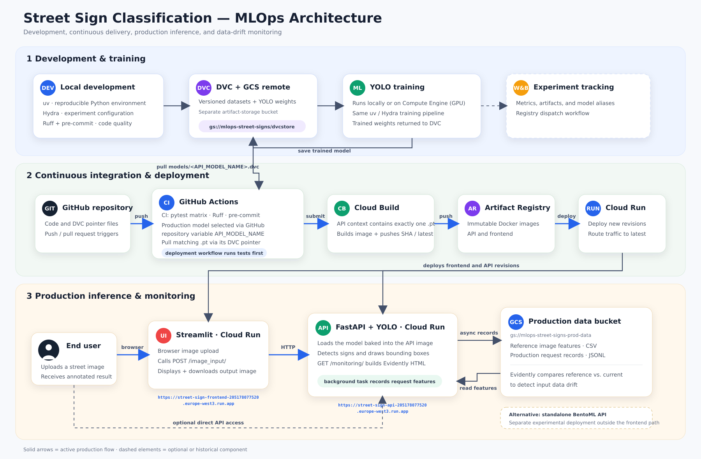

# Street Sign Project

The project serves a YOLO street-sign detector through FastAPI and publishes API and frontend images to
Artifact Registry.

## System architecture

The overview shows how local development, continuous integration and deployment, cloud services, model serving and
production monitoring fit together.

Training saves a checkpoint and logs metrics and the model artifact to W&B. Deployment selects
an explicit checkpoint through `API_MODEL_NAME` and DVC.

## Image publishing

The `Test, build, and publish FastAPI` (`cloudbuild_api.yaml`) and
`Test, build, and publish Streamlit frontend` (`cloudbuild_frontend.yaml`) GitHub Actions workflows run on relevant
pushes to `main` or can be started manually on `main`. They install the locked development environment, run the tests, and
submit builds to Cloud Build. The API workflow first downloads the checkpoint selected by `API_MODEL_NAME` from DVC.

Both builds publish a unique `<commit-sha>-<run-id>-<run-attempt>` tag and `latest` to Artifact Registry using the
existing Cloud Build configurations and AMD64 architecture. Publishing is serialized per service; manual runs on
other branches are skipped. These workflows do not deploy services or configure registry retention.

Both workflows use the existing `GCP_API_DEPLOY_CREDENTIALS` repository secret. Publishing needs
`roles/storage.objectUser` on the Cloud Build staging bucket and `roles/cloudbuild.builds.editor` on the project;
the API workflow also needs `roles/storage.objectViewer` on the DVC bucket. The Cloud Build service account needs
`roles/artifactregistry.writer` on the image repository. Cloud Run deployment permissions are not required by the
new build workflows.

Shared repository variables are `GCP_PROJECT_ID`, `GCP_REGION`, `GAR_REPOSITORY`, and `CLOUD_BUILD_STAGING_BUCKET`.
The API build also uses `API_IMAGE_NAME` and `API_MODEL_NAME`; the frontend build uses `FRONTEND_IMAGE_NAME`.
Their defaults are listed in the Cloud Run reference tables below.

Registry cleanup policies and on-premises deployment are deferred. The Cloud Run workflows below are retained as
retired showcase examples. Their complete contents and triggers are unchanged, and retirement is managed by disabling
them in GitHub. Verify the renamed workflows remain disabled after publishing the rename.

## API deployment (retired Cloud Run example)

The `Test, build, and deploy FastAPI` GitHub Actions workflow (`deploy_api_cloudrun.yaml`) retains the full deployment
flow. If enabled in GitHub, on relevant pushes to `main`, or when started manually, it:

1. installs the locked development environment and runs the test suite;
2. downloads the configured API model from the DVC GCS remote;
3. submits the FastAPI container build to Google Cloud Build;
4. pushes commit-specific and `latest` image tags to Artifact Registry; and
5. deploys the commit-specific image to Cloud Run.

Configure the service-account JSON as the `GCP_API_DEPLOY_CREDENTIALS` repository secret. Grant that service account
`roles/storage.objectViewer` on the DVC bucket, `roles/storage.objectUser` on the Cloud Build staging bucket,
`roles/cloudbuild.builds.editor` and `roles/run.admin` on the project, `roles/artifactregistry.reader` on the image
repository, and `roles/iam.serviceAccountUser` on the Cloud Run runtime service account. The Cloud Build service account
needs `roles/artifactregistry.writer` on the image repository. The Cloud Run runtime service account needs
`roles/storage.objectUser` on the monitoring bucket.

The workflow supports these optional repository variables:

| Variable                     | Default                             |
| ---------------------------- | ----------------------------------- |
| `GCP_PROJECT_ID`             | `mlops-steetsigns`                  |
| `GCP_REGION`                 | `europe-west3`                      |
| `GAR_REPOSITORY`             | `docker-registry`                   |
| `API_IMAGE_NAME`             | `street-sign-api`                   |
| `CLOUD_RUN_API_SERVICE`      | `street-sign-api`                   |
| `API_MODEL_NAME`             | `YOLO_eps420_bs8_lr0.005_fr10_x.pt` |
| `MONITORING_BUCKET`          | `mlops-street-signs-prod-data`      |
| `MONITORING_PREFIX`          | `production`                        |
| `API_PORT`                   | `8000`                              |
| `CLOUD_RUN_CPU`              | `2`                                 |
| `CLOUD_RUN_MEMORY`           | `4Gi`                               |
| `CLOUD_RUN_MIN_INSTANCES`    | `0`                                 |
| `CLOUD_RUN_MAX_INSTANCES`    | `1`                                 |
| `ALLOW_UNAUTHENTICATED`      | `true`                              |
| `CLOUD_BUILD_STAGING_BUCKET` | `mlops-steetsigns_cloudbuild`       |

## Frontend deployment (retired Cloud Run example)

The `Test, build, and deploy Streamlit frontend` GitHub Actions workflow (`deploy_frontend_cloudrun.yaml`) retains the
full deployment flow. If enabled in GitHub, on relevant pushes to `main`, or when started manually, it:

1. installs the locked development environment and runs the test suite;
2. submits the Streamlit container build to Google Cloud Build;
3. pushes commit-specific and `latest` image tags to Artifact Registry; and
4. deploys the commit-specific image to Cloud Run with the production API URL locked in the runtime environment.

The workflow uses the same `GCP_API_DEPLOY_CREDENTIALS` repository secret and service account as the API workflow. The
service account needs `roles/storage.objectUser` on the Cloud Build staging bucket, `roles/cloudbuild.builds.editor` and
`roles/run.admin` on the project, `roles/artifactregistry.reader` on the image repository, and
`roles/iam.serviceAccountUser` on the Cloud Run runtime service account. The Cloud Build service account needs
`roles/artifactregistry.writer` on the image repository.

The workflow supports these optional repository variables:

| Variable                         | Default                                                      |
| -------------------------------- | ------------------------------------------------------------ |
| `GCP_PROJECT_ID`                 | `mlops-steetsigns`                                           |
| `GCP_REGION`                     | `europe-west3`                                               |
| `GAR_REPOSITORY`                 | `docker-registry`                                            |
| `FRONTEND_IMAGE_NAME`            | `street-sign-frontend`                                       |
| `CLOUD_RUN_FRONTEND_SERVICE`     | `street-sign-frontend`                                       |
| `FRONTEND_API_URL`               | `https://street-sign-api-205178077520.europe-west3.run.app/` |
| `FRONTEND_PORT`                  | `8080`                                                       |
| `FRONTEND_CPU`                   | `1`                                                          |
| `FRONTEND_MEMORY`                | `1Gi`                                                        |
| `FRONTEND_MIN_INSTANCES`         | `0`                                                          |
| `FRONTEND_MAX_INSTANCES`         | `1`                                                          |
| `FRONTEND_ALLOW_UNAUTHENTICATED` | `true`                                                       |
| `CLOUD_BUILD_STAGING_BUCKET`     | `mlops-steetsigns_cloudbuild`                                |

The local Cloud Run deployment scripts and their Invoke tasks have been removed. The retired GitHub Actions workflows
above document API and frontend cloud deployment; their repository variables configure deployment settings.
